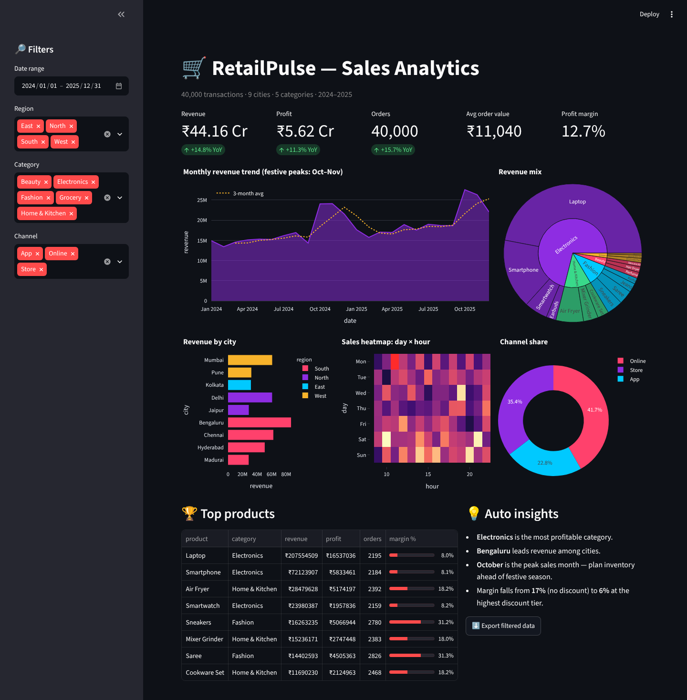
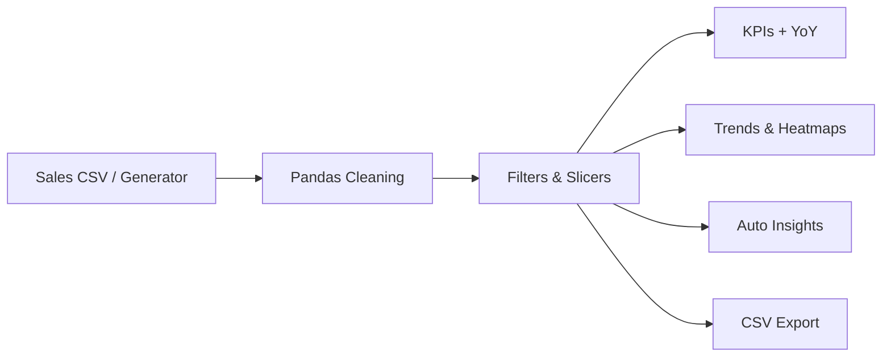

<div align="center">

# 🛒 RetailPulse — Retail Sales Analytics Dashboard

**A Power BI-style interactive dashboard in pure Python — 40,000 transactions, 9 cities, instant insights.**

    

`Data Analysis · Business Intelligence`

</div>

---



## 📌 Problem Statement

Retail managers need one place to see revenue, profit and customer behaviour across cities, categories and channels — and spot seasonality early.

## ✨ Key Features

- Sidebar **slicers**: date range, region, category, channel
- KPI cards with **YoY growth**: revenue, profit, orders, AOV, margin
- Monthly trend with **3-month moving average** (festive-season peaks)
- Sunburst revenue mix, city ranking, **day × hour heatmap**, channel share
- Top-products table with margin bars and **auto-generated insights**
- Export filtered data to CSV

## 🏗️ Architecture



## ⚙️ How It Works

1. Synthetic sales with realistic seasonality (Oct–Nov festive peak), weekend lift, growth trend, discounts and category margins.
2. Pandas `groupby`, `resample` and `pivot_table` power every visual; filters cascade to all charts.
3. Insights are computed from the filtered data (most profitable category, top city, peak month, discount impact on margin).

## 🧰 Tech Stack

| Layer | Tools |
|---|---|
| Language | Python 3.10+ |
| ML / Logic | pandas, numpy |
| UI & Visualisation | Streamlit, Plotly |

## 📁 Project Structure

```
RETAIL-SALES-ANALYTICS-DASHBOARD/
├── app.py             # Dashboard layout, KPIs, charts, insights
├── data.py            # Synthetic multi-city transaction generator
├── assets/              # screenshots
├── requirements.txt
└── README.md
```

## 🚀 Getting Started

```bash
git clone https://github.com/PreciousBharath/RETAIL-SALES-ANALYTICS-DASHBOARD.git
cd RETAIL-SALES-ANALYTICS-DASHBOARD
python -m venv venv && source venv/bin/activate   # Windows: venv\Scripts\activate
pip install -r requirements.txt
streamlit run app.py
```

Open **http://localhost:8501** in your browser.

> The project ships with a realistic built-in demo dataset, so it runs out of the box with no downloads or API keys.

## 🗺️ Roadmap

- [ ] Sales forecasting with Prophet
- [ ] Connect to MySQL / Google Sheets
- [ ] Scheduled PDF report emails

## 👨‍💻 Author

**Bharath** — Software Developer · Project Engineer · Technical Trainer

[](https://linkedin.com/in/connectbharath)
[](https://itsbharathportfolio.netlify.app)
[](https://github.com/PreciousBharath)

⭐ If this project helped you, please give it a star!

## 📄 License

Released under the [MIT License](LICENSE).
